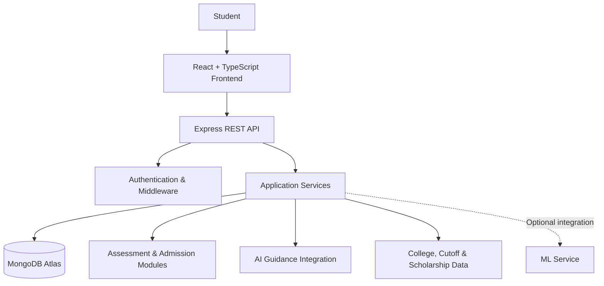

# 🎓 MentoraAI — One-Stop Personalized Career & Education Advisor

### Because Every Student Deserves a Mentor

**An AI-powered education and career guidance platform designed to help students make informed decisions about their academic future.**

MentoraAI brings scientific assessments, government college discovery, cutoff prediction, scholarship exploration, admission tracking, alumni networking, and AI-assisted career guidance into one integrated platform.

> **Our mission:** Make personalized, data-informed education and career guidance more accessible to students, especially those who lack access to dedicated mentors and reliable counseling resources.

[Explore the Repository](https://github.com/Satwik265/MentoraAI)

---

## 🚨 The Problem

Choosing the right academic and career path is difficult for students navigating fragmented information and complex admission processes.

- **Information fragmentation:** College details, cutoffs, scholarships, and admission information are scattered across multiple platforms.
- **Limited personalized guidance:** Many students struggle to identify suitable academic pathways based on their interests, aptitude, and goals.
- **Admission uncertainty:** Understanding eligibility, deadlines, documents, and counseling procedures can be overwhelming.
- **Unequal access to mentorship:** Students without access to experienced counselors often make high-impact decisions with incomplete information.

MentoraAI addresses these challenges through a unified, student-centric digital guidance ecosystem.

## 💡 Our Solution

MentoraAI combines structured student assessments, education discovery tools, admission-planning workflows, and AI-assisted guidance in a single platform.

Instead of forcing students to navigate disconnected resources, the platform aims to help them move from **self-discovery → exploration → decision-making → admission planning**.

## ✨ Key Features

### 🧠 1. Scientific Student Assessment
- Structured assessments designed to help students understand their interests and academic preferences.
- Assessment-driven guidance and personalized learning or career roadmaps.
- Step-by-step evaluation flow with progress feedback.

### 🏛️ 2. Government College Discovery
- Explore government colleges through a dedicated discovery interface.
- Search and filter college information.
- Present relevant metrics such as fees, placements, campus information, and seat availability when supported by available data.
- Organize seat information to make college comparison easier.

### 🎯 3. Cutoff Prediction
- Dedicated cutoff prediction interface to support college-selection decisions.
- Designed to help students explore admission possibilities using relevant academic and admission data.
- Intended to complement—not replace—official eligibility criteria and counseling guidance.

### 📅 4. Admission Tracker
- Organize admission stages and important milestones.
- Track document verification and application progress.
- Provide access to relevant official counseling resources.

### 🎓 5. Scholarship Discovery
- Explore scholarship opportunities relevant to students.
- Help students identify potential financial assistance options.
- Support more informed education planning.

### 🤖 6. AI Guidance Hub
- Conversational interface for education and career-related questions.
- Quick prompts to help students explore relevant topics.
- Designed to make guidance more accessible and interactive.

### 🌐 7. Alumni Network
- A dedicated space for alumni discovery and mentorship-oriented connections.
- Designed to bridge the gap between students and people with relevant academic or professional experience.

### 🎨 8. Accessible, Customizable Experience
- **Midnight Black:** A focused, high-contrast dark interface.
- **Espresso Brown:** Warm, refined visual styling.
- **Warm Ivory:** A lighter reading-friendly interface.
- Multilingual interface support and speech-accessibility controls.
- Responsive, component-based frontend architecture.

---

## 🏗️ System Architecture

MentoraAI uses a TypeScript-based frontend and backend architecture with MongoDB for persistent data storage.



### Architecture Overview

| Layer | Technology | Responsibility |
|---|---|---|
| Frontend | React, TypeScript, Vite | User interface and interactions |
| Backend | Node.js, Express, TypeScript | API endpoints and application logic |
| Database | MongoDB Atlas | Persistent application data |
| Styling | CSS, CSS variables | Theme system and interface design |
| AI/ML | AI integrations and optional ML service | Intelligent guidance and predictive workflows |
| Version Control | Git, GitHub | Source code management |

*The diagram represents the intended application architecture. External integrations and individual modules must be configured and verified in the deployed environment.*

---


## 📂 Project Structure

```text
MentoraAI/
├── data/                 # Application data and supporting resources
├── server/
│   ├── src/
│   │   ├── config/       # Configuration
│   │   ├── controllers/  # Request handlers
│   │   ├── middleware/   # Request processing and access control
│   │   ├── models/       # Data models
│   │   ├── routes/       # API routes
│   │   ├── services/     # Application services
│   │   └── utils/        # Shared utilities
│   └── ...
├── src/
│   ├── components/       # Reusable UI components
│   ├── services/         # Frontend service integrations
│   ├── App.tsx
│   └── ...
├── .env.example
├── .gitignore
├── index.html
├── package.json
├── server.ts
├── tsconfig.json
└── vite.config.ts
```

*This structure summarizes the repository layout; exact filenames and responsibilities may vary as development progresses.*

---

## ⚙️ Getting Started

### Prerequisites

- Node.js and npm
- A MongoDB Atlas account or another supported MongoDB deployment
- Git
- API credentials for any external services you enable

### 1. Clone the repository

```bash
git clone https://github.com/Satwik265/MentoraAI.git
cd MentoraAI
```

### 2. Install dependencies

```bash
npm install
```

### 3. Configure environment variables

Create a `.env` file based on `.env.example` and provide the values required by the application.

```env
MONGODB_URI=mongodb+srv://<username>:<password>@<cluster-host>/<database>
JWT_ACCESS_SECRET=<your-access-token-secret>
JWT_REFRESH_SECRET=<your-refresh-token-secret>
ML_SERVICE_URL=<your-ml-service-url>
CLIENT_URL=<your-frontend-origin>
```

**Security notes:**
- Never commit `.env` files or real credentials.
- Use long, randomly generated JWT secrets.
- URL-encode special characters in MongoDB connection credentials.
- Leave optional integrations unconfigured until the corresponding services are available.

Check the actual environment-variable names referenced by the backend before starting the application.

### 4. Start the application

The exact scripts depend on the current `package.json`.

For a Vite frontend, the usual development command is:

```bash
npm run dev
```

If the project has a separate backend script, open another terminal and run the corresponding backend command defined in `package.json`.

### 5. Verify the integration

- Open the application in your browser.
- Confirm the backend health endpoint responds, if configured.
- Test registration and login.
- Verify that expected database documents are created in MongoDB Atlas.
- Test the assessment, college discovery, cutoff, scholarship, and AI guidance flows.
- Inspect browser and backend logs for failed requests.

---

## 🔐 Security & Reliability

MentoraAI is designed around a modular backend that can support maintainable and secure application development.

Recommended production checks include:

- Server-side input validation.
- Secure password hashing and authentication.
- Authorization checks on protected endpoints.
- Rate limiting and appropriate CORS configuration.
- Secure storage of secrets and external API credentials.
- Appropriate protection of student data.
- Error handling, logging, and API monitoring.
- Validation of AI-generated guidance against trusted sources.

Production readiness should be confirmed through implementation review and end-to-end testing.

---

## 🌍 Expected Impact

MentoraAI aims to help students:

- Discover academic options more efficiently.
- Compare colleges and admission possibilities.
- Understand scholarship and admission requirements.
- Make more informed education and career decisions.
- Access guidance without depending entirely on one-to-one counseling.

### Our Vision

A future where every student can access clearer information, personalized guidance, and practical tools to navigate their educational journey—regardless of their location or background.

---

## 🚀 Future Roadmap

- [ ] Personalized recommendations based on assessment results.
- [ ] Verified and regularly updated college, cutoff, and scholarship datasets.
- [ ] Improved prediction models with transparent evaluation metrics.
- [ ] Deadline reminders and admission notifications.
- [ ] Expanded multilingual and accessibility support.
- [ ] Alumni mentorship and student community features.
- [ ] Deployment monitoring and automated testing.
- [ ] Privacy-conscious analytics to measure real student outcomes.

---

## 👥 Team & Contributions

**Project:** MentoraAI — One-Stop Personalized Career & Education Advisor

**Developer:** [Add team members and individual contributions]

Built with a focus on accessible education guidance, practical software engineering, and responsible AI integration.

Contributions, issue reports, and suggestions are welcome through GitHub Issues and Pull Requests.

---

## 📜 License

A license has not yet been specified. Add an appropriate `LICENSE` file before distributing the project under open-source terms.

---

### ⭐ Support the Project

If MentoraAI's mission resonates with you, explore the repository, share feedback, and help make education guidance more accessible.

**MentoraAI — Because Every Student Deserves a Mentor.**
